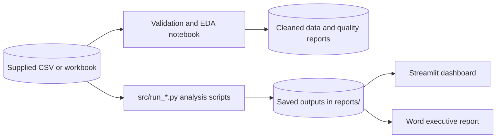

<h1 align="center">Sugar Cosmetics Instagram Analytics</h1>

<p align="center">
  <b>A reproducible, uncertainty-aware analysis of Instagram performance data, delivered as a Streamlit dashboard, a validated EDA notebook and an executive report.</b>
</p>

<p align="center">
  
  
  
  
  
  
</p>

<p align="center">
  <a href="#overview">Overview</a> ·
  <a href="#key-findings">Key findings</a> ·
  <a href="#dashboard-pages">Dashboard</a> ·
  <a href="#quick-start">Quick start</a> ·
  <a href="#reproducible-analysis">Analysis</a> ·
  <a href="#repository-structure">Structure</a> ·
  <a href="#limitations-and-scope">Limitations</a>
</p>

<!--
DASHBOARD PREVIEW: add screenshots to the images/ folder, then uncomment and update the paths.

<p align="center">
  
</p>
-->

---

## Overview

This project analyzes a supplied Instagram analytics dataset (50,000 records, 14 columns, 19 Apr 2024 to 19 Apr 2025) to answer a practical question: **what does the data support, and what should be tested before changing content or budget decisions?**

It covers the full analyst workflow: data validation, exploratory analysis, descriptive uncertainty, leakage-aware predictive modeling, business decision planning and stakeholder reporting.

> [!IMPORTANT]
> The dashboard analyzes the records in the supplied dataset. It does **not** verify that the records came from Sugar Cosmetics' official account or represent its actual posting history. The collection process and row grain are undocumented, and there is no post identifier, attributable sales, revenue or spend data. Describe results as findings about this dataset, not as verified brand performance or causal impact. See [DATA_PROVENANCE.md](DATA_PROVENANCE.md).

### What this project demonstrates

| Skill | Where it shows up |
|---|---|
| Data validation and quality auditing | Schema, missing-value, duplicate, integrity and outlier checks with a non-destructive cleaning log |
| Exploratory data analysis | Univariate, bivariate and multivariate views of format, campaign, timing and hashtags |
| Statistical inference | Simultaneous 95% moving date-block bootstrap intervals with block-length sensitivity checks |
| Machine learning evaluation | 58 configurations across 18 model families, temporal cross-validation and an untouched future holdout |
| Business framing | Assumed Marketing and Finance test portfolio with sample-size planning and scenario economics |
| Engineering practice | Reproducibility manifest, locked dependencies, unit tests and GitHub Actions CI |
| Communication | Interactive dashboard and an auto-generated Word executive report |

## Key findings

All figures describe the supplied dataset.

| Area | Result |
|---|---|
| **Baseline** | **18.55%** weighted engagement rate: 183.2M engagements on 987.4M summed post-level reach |
| **Data quality** | 0 missing cells, 0 exact duplicate rows, 0 invalid dates; provenance and row grain unverified |
| **Post format** | Story is highest (18.63%), Image is lowest (18.42%). Only the Image gap (about -0.18 pp) has an interval that excludes zero |
| **Campaign** | Rates range from 18.45% (Festive Offer) to 18.63% (Influencer Collab); no campaign interval excludes zero |
| **Timing** | Weekday rates differ by only about 0.14 pp; Friday is highest |
| **Pre-publication model** | The best ML candidate (Poisson regression) is tied with the median baseline on the future holdout, so the one-standard-error rule selects the baseline |
| **Exposure-conditional model** | Ridge MAE of 1,240 vs 2,120 engagements for the baseline (R² 0.62). Exploratory only, because it uses realized reach and impressions |

**Takeaway:** category differences are small, so the right next step is a controlled format and message test with attributed conversion outcomes, not a budget shift.

## Dashboard pages

| Page | What it answers |
|---|---|
| **Executive Overview** | Selected-scope KPIs, trends and summary findings |
| **Content Performance** | Engagement by post format and campaign |
| **Hashtag Intelligence** | Hashtag use and observed engagement patterns |
| **Audience & Conversion Funnel** | Reach, engagement, profile-visit and follow proxies |
| **Posting Strategy** | Filtered cadence, monthly patterns and weekday comparisons |
| **Deep Dive and Data Quality** | Validation findings, record inspection, filters and downloads |
| **Strategic Recommendations** | Uncertainty-aware comparisons, assumed Marketing and Finance test portfolio, sample-size planning, scenario calculations and optional attributed-impact analysis |
| **Predictive Model Validation** | Leakage-aware model comparison, overfit checks, holdout errors and a separate exploratory exposure-conditional estimate |

## Quick start

**Windows (PowerShell)**

```powershell
py -3.14 -m venv .venv
.\.venv\Scripts\Activate.ps1
python -m pip install --upgrade pip
python -m pip install -r requirements-lock.txt
streamlit run Home.py
```

**macOS / Linux**

```bash
python3 -m venv .venv
source .venv/bin/activate
python -m pip install --upgrade pip
python -m pip install -r requirements.txt
streamlit run Home.py
```

> [!NOTE]
> `requirements-lock.txt` captures the exact environment (Python 3.14.7 on Windows when recorded). On another compatible Python version, use `requirements.txt`, which lists the supported dependency ranges.

The app reads `data/sugar_cosmetics_instagram_data.csv` by default and falls back to the workbook if the CSV is absent.

## Reproducible analysis

Run commands from the repository root inside the virtual environment.



The JSON and prediction CSV files in `reports/` are saved analysis outputs, not temporary caches. Dashboard pages and the report builder load them so expensive model and uncertainty calculations do not rerun on every refresh. The scripts below regenerate them.

| Step | Command | Main outputs |
|---|---|---|
| Data validation and EDA | Run `notebooks/01_data_validation_and_eda.ipynb` top to bottom | `data/sugar_cosmetics_instagram_cleaned.csv`, `reports/data_quality_report.json`, `reports/data_quality_checks.csv`, `reports/outlier_screening.csv` |
| Pre-publication model search | `python src/run_model_evaluation.py` | `reports/model_evaluation.json`, `reports/model_holdout_predictions.csv` |
| Exposure-conditional volume model | `python src/run_conditional_engagement_volume.py` | `reports/conditional_engagement_volume.json`, `reports/conditional_engagement_volume_predictions.csv` |
| Category uncertainty | `python src/run_descriptive_inference.py` | `reports/category_rate_inference.json` |
| Assumed decision portfolio | `python src/run_decision_portfolio.py` | `reports/assumed_decision_portfolio.json` |
| Reproducibility manifest | `python src/reproducibility_manifest.py` | `reports/reproducibility_manifest.json` |
| Executive report | `python src/build_executive_report.py` | `reports/Sugar_Cosmetics_Instagram_Executive_Report.docx` |

Refresh the analysis outputs before building the executive report.

<details>
<summary><b>Data validation and EDA notebook</b></summary>

The notebook reads the dashboard's source CSV (with workbook fallback), normalizes and checks fields, and presents each table and chart in its own focused cell. It flags outliers for review and never removes them. The dashboard itself reads the original project CSV rather than the notebook's cleaned derivative.

To recreate the notebook from its generator, run `python src/build_eda_notebook.py`.

</details>

<details>
<summary><b>Pre-publication engagement-rate model search</b></summary>

- **Target:** total engagements divided by positive reach.
- **Inputs:** pre-publication metadata only: post type, campaign, their interaction, canonical hashtag set and count, and calendar features. Reach, impressions, engagement counts, visits, follows and potentially post-outcome annotations are excluded. Preprocessing is fitted inside each fold.
- **Validation:** the latest 20% of unique dates are kept as a future holdout. Earlier data uses four expanding-window, date-grouped folds with a seven-day gap.
- **Search:** 58 configurations across 18 scikit-learn model families, including linear and regularized models, robust and generalized linear models, decision trees, boosting, forests, K-nearest neighbors and a small neural network. Kernel SVR is excluded because its quadratic training cost is impractical at this dataset size.
- **Selection:** candidates are ranked by temporal-CV MAE. The report marks both the best ML candidate and the simpler approach chosen by the one-standard-error rule. The holdout is never used for tuning.
- **Result:** Poisson regression is the best ML candidate, but its holdout MAE is effectively tied with the median baseline and the date-block interval includes no difference. This is an evaluation result, not a deployed forecasting service.

</details>

<details>
<summary><b>Exposure-conditional engagement-volume model</b></summary>

A separate exploratory Ridge analysis predicts likes, comments, shares and saves conditional on already observed reach and impressions, alongside hashtag count and content and campaign metadata. Because it uses realized exposure and was selected after reviewing this dataset, it is **not** a pre-publication forecast or confirmatory evidence of generalizable performance.

</details>

<details>
<summary><b>Descriptive category uncertainty</b></summary>

Weighted engagement-rate contrasts for post types and campaigns use simultaneous 95% moving date-block bootstrap intervals (5,000 resamples by default), plus three- and fourteen-day block-length sensitivity analyses. Intervals are conditional on the supplied data and resampling assumptions. They do not adjust for confounding or establish causality.

</details>

<details>
<summary><b>Assumed decision portfolio and reproducibility manifest</b></summary>

`run_decision_portfolio.py` recreates the illustrative Marketing and Finance test decisions, sample-size calculations and scenario assumptions shown in the dashboard. Replace assumptions with stakeholder-approved values and controlled-test results before treating scenarios as business outcomes.

`reproducibility_manifest.py` records source-data and code hashes, package and runtime versions, input-file consistency checks, row density, category balance and the available Git revision. Pass `--source path\to\file` to fingerprint another source file and `--output path\to\manifest.json` to choose an output path. A hash identifies file bytes; it does not establish data authenticity or provenance.

</details>

## Metrics

| Metric | Definition |
|---|---|
| Total engagements | likes + comments + shares + saves |
| Post engagement rate | total engagements ÷ reach, when reach is positive |
| Weighted engagement rate | sum of eligible engagements ÷ sum of eligible reach for the selected group |
| Profile-visit rate proxy | profile visits ÷ reach |
| Follow-per-visit proxy | follows ÷ profile visits, when profile visits are positive |
| Record count | number of dataset rows; not a post count unless the row grain is verified |

Reach is post-level reach summed across records, not unique account reach. Hashtag-level views can include one record in several hashtag groups. Ratios with zero denominators are missing.

## Repository structure

```text
.
├── Home.py                          Streamlit entry point
├── pages/                           Dashboard pages
├── src/
│   ├── analytics.py                 Shared data loading, metrics and validation
│   ├── modeling.py                  Temporal model evaluation
│   ├── inference.py                 Descriptive uncertainty calculations
│   ├── conditional_engagement_model.py  Exposure-conditional model
│   ├── decision_portfolio.py        Assumed decisions and scenarios
│   ├── business_impact.py           Attribution-data validation and calculations
│   └── build_eda_notebook.py        Rebuild the validation and EDA notebook
├── utils/                           Shared helpers
├── notebooks/                       Data audit and exploratory analysis
├── data/                            Supplied data and attribution template
├── reports/                         Reproducible analysis outputs and review notes
├── images/                          Project images
├── tests/                           Unit and dashboard smoke checks
├── .github/workflows/               Continuous integration
├── requirements.txt                 Supported dependency ranges
├── requirements-lock.txt            Exact captured environment
├── DATA_PROVENANCE.md
├── BUSINESS_IMPACT_DATA_CONTRACT.md
├── MODEL_MONITORING_PLAN.md
└── PROJECT_REVIEW_CHECKLIST.md
```

## Tests and continuous integration

```bash
python -m pytest -q
python -m compileall -q Home.py pages src utils tests
```

GitHub Actions runs these checks on pushes and pull requests. The project does not include a production data feed, deployed model, scheduled retraining or configured monitoring alerts; see the [model monitoring plan](MODEL_MONITORING_PLAN.md).

## Limitations and scope

- **Descriptive, not causal.** The analysis can describe observed engagement-rate differences and use them to form hypotheses for controlled tests. It cannot show that a content change causes more engagement, sales or profit.
- **Provenance is unverified.** Source identity, collection method and historical integrity are not independently confirmed.
- **Scenario economics are assumptions.** Decision scenarios are planning examples. Actual financial impact needs a validated attribution export that follows the [business-impact data contract](BUSINESS_IMPACT_DATA_CONTRACT.md).
- **No sales, spend or post-level identifiers.** Visit and follow ratios are aggregate proxies, not attributed conversions.

## Documentation

| Document | Purpose |
|---|---|
| [Data provenance](DATA_PROVENANCE.md) | Source review and verification limits |
| [Business-impact data contract](BUSINESS_IMPACT_DATA_CONTRACT.md) | Attribution data required to measure real impact |
| [Model monitoring plan](MODEL_MONITORING_PLAN.md) | Monitoring and retraining plan |
| [Project review checklist](PROJECT_REVIEW_CHECKLIST.md) | Review checklist for the project |
| [Implementation review](reports/implementation_review.md) | Latest implementation review |

## Author

**Kartikey Singh**, Business Analyst
GitHub: [@T3MP35TT](https://github.com/T3MP35TT)
